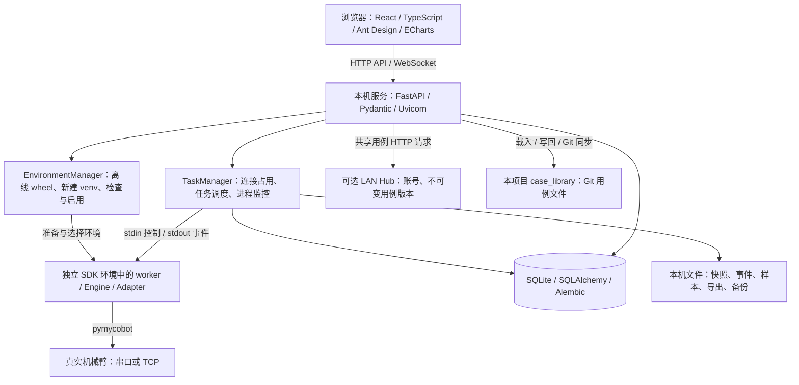

# Elephant Test Workbench

本机机械臂测试工作台，当前版本 **0.5.0**。通过浏览器管理真实设备、离线 SDK、用例编排、测试执行与本机证据，用例随本项目源码仓库通过 Git 管理与同步。

项目完全独立，自行管理设备配置、用例、环境和结果，运行时不读取或执行其他工程的数据和代码。产品仅支持真实设备，没有模拟模式或内置演示结果。已按授权将 elephant-pytest 的用例参数与逻辑依据一次性迁入本项目；默认启动载入这些真实用例资产。pytest 用于验证本应用，不是执行其他工程测试脚本的桥接入口。

## 阅读导航

- 首次使用：先看“安装与启动”，再按“从零完成一次测试”操作。
- 了解实现：看“技术架构”和“目录职责”。
- 团队维护：看“局域网用例共享”“数据、导出与备份”和“开发与验证”。
- 排查问题：看“常见问题”和“当前验证与已知限制”。

## 三个模块的工作流

- **用例库**：检索、编写和管理单条用例。点击编辑进入库内步骤编辑器，保存后可准备试跑或加入计划。Git 操作位于折叠的“版本与同步”；“整改进度”可下载逐例台账。
- **用例编排**：创建并保存多用例测试计划。选择用例、调整条目顺序、选择数据组、设置重复和声明参数覆盖；允许 A → B → A，条目ID独立。保存时固定引用定义和内容哈希，用例更新后需查看差异并明确更新引用。
- **测试执行**：选择已保存用例或计划，核对当前设备/SDK、最终参数和顺序，运行前预检后确认现场条件，再开始。其他页面的“准备运行”只带入选择，不创建任务或占用设备。

未保存内容须先保存。允许本机草稿试跑，报告标记实际来源和内容哈希，Git HEAD只作上下文；未提交内容不会冒充该提交。开始时重新校验预检指纹，内容/环境改变会阻断并要求重新预检。运行后编辑、文件同步不会改变已有任务快照。

运行监控按条目、数据组、重复序号记录日志、断言及恢复；暂停在用例及恢复完成后的边界生效。恢复失败或状态未知始终停止，普通失败恢复成功后按计划策略处理。任务结束显示历史快照，当前连接仍由右上角状态独立表示；连接和接口调试不混入测试任务选择器。

首次升级会通过新增的 Alembic 0002 创建 plans 表，不改写已发布迁移。计划定义及其引用快照与用例一起写回文件、Git提交/同步；设备连接与结果仍保存在本机。原版本数据库升级前请在任务空闲、断开连接后做完整备份。

## 安装与启动

### 1. 环境要求

- Python **3.10+**，用于本机服务与独立 SDK 环境。
- 从源码安装还需 Node.js **22.12+**、pnpm **11.25.0**；本机已验证 Node.js 24。
- 浏览器；本机浏览器流程使用 Edge 验证。
- 实际执行需要匹配机型的 pymycobot 离线 wheel、可用设备连接及现场允许的操作范围。

当前随包提供的 NumPy wheel 对应 **Windows AMD64 / Python 3.10**。为其他系统或 Python 版本安装、打包时，需要重新准备匹配的基础 wheel；不能直接将当前包视为跨平台二进制发行包。Linux 实际运行仍待验收。

### 2. 首次从源码安装

在项目根目录执行：

```powershell
python scripts/bootstrap.py
cd frontend
pnpm install --frozen-lockfile
pnpm build
cd ..
python start.py
```

`bootstrap.py` 创建项目 `.venv`，安装应用及测试依赖，并准备匹配当前解释器的 pyserial、NumPy wheel。此步骤默认可能联网；**界面中的 SDK 导入始终离线**，两者属于不同安装阶段。

`pnpm build` 先做 TypeScript 检查，再将网页构建到 `src/workbench/web/`，由 Python 服务提供。源码首次运行前需完成这一步。

### 3. 日常启动与退出

安装完成后：

- Windows：双击 `start.cmd`，或在根目录执行 `python start.py`。
- Linux：在根目录执行 `sh start.sh`，使用项目 `.venv`。
- 浏览器地址：[http://127.0.0.1:8765](http://127.0.0.1:8765)。`start.py` 会在服务就绪后尝试自动打开浏览器。
- 服务不安装为常驻服务。退出前先在页面完成任务停止、恢复与连接断开，再在启动终端按 Ctrl+C。

启动网页本身不会自动连接机械臂。浏览器关闭不会结束后台任务；进程退出也不代表设备已经停止。

自定义端口与数据目录：

```powershell
python start.py --port 8767 --data ./data
```

同一数据目录只能运行一个本机服务。开发与正式使用应选用不同数据目录。

### 4. 离线安装与发行包

源码的 Python 依赖可通过完整离线 wheel 目录安装：

```powershell
python scripts/bootstrap.py --wheelhouse C:/offline/platform-wheels
```

该目录需包含当前系统/Python 所需的应用、测试、构建及基础依赖 wheel。这个参数只覆盖 Python 安装；源码网页构建还需要准备好 pnpm 依赖或相应离线缓存。

发布 wheel 已包含网页与数据库迁移，不要求用户再构建前端，但仍需要 Python 和平台依赖，**不是独立 exe**。在已准备好的独立 Python 环境中安装并启动：

```powershell
python -m pip install ./dist/elephant_test_workbench-0.5.0-py3-none-any.whl
python -m workbench run --open
```

上述 pip 命令默认可联网解析平台依赖；完全离线时使用 `--no-index --find-links` 指向完整平台依赖目录。发行包安装入口为 `python -m workbench` 或 `elephant-workbench`；`start.py` 是源码目录下使用 `.venv` 的入口。

## 从零完成一次测试

### 1. 准备并选择 SDK 环境

1. 打开 **设置 → 运行环境**，上传本地 pymycobot wheel，或包含 wheel 与 `manifest.json` 的 zip。
2. 等待候选环境进入 `ready`，展开安装记录检查 SDK 版本、依赖检查和导入结果。
3. 空闲时点击 **启用 / 回退**；也可在设备管理中明确选择某个已就绪环境。

平台自动向新 SDK 环境离线安装 pyserial、NumPy，无需用户随 SDK 重复上传。这些基础 wheel 的来源、哈希与许可证记录在 `src/workbench/bundled_wheels/NOTICE.txt`。其他 SDK 专属依赖按实际版本提供。

每次导入都创建独立环境，旧环境保留；不会覆盖正在使用的 SDK、借用其他项目环境或联网补包。`ready` 表示依赖与导入检查成功，不代表设备或固件兼容性已经通过。清单字段可参考 `examples/offline-manifest.json`，其中占位版本及依赖列表需按实际需要调整。

### 2. 配置并连接设备

1. 在顶部选择机型，进入 **设备管理**。
2. 串口机型填写串口和波特率；Pro 450 填写控制器 IP、TCP 端口（默认 `4500`）和连接超时（默认 `8` 秒），不使用波特率。
3. 双臂机型填写左右串口，并选择当前操作侧。
4. 选择 SDK 环境，保存配置，再点击右上角或设备页的 **连接**，确认现场条件。
5. 位置及运动状态实际读回有效后，右上角才显示 **已连接**。设备页随后展示主控、末端、屏幕及修订版本；不同机型/SDK 不支持的字段明确标识，读取失败保留错误。

保存配置不等于建立连接。空闲连接约每 0.5 秒校验读回，首次连接需有效读回；已建立会话的空读回显示状态异常并保留调试通道，便于显式调用状态/上电等接口。连续 3 次实际通信异常会关闭失效会话；遥测过期会标注状态待更新，不冒充有效在线。后续任务串行复用同一执行器，Web 服务和监视页面不会另开 SDK 连接。更换 SDK、机型或连接配置后应断开重连。

网页要求先完成连接校验才能提交业务任务；后端也保留未建立持久会话时的独立任务建连路径，现场使用按网页流程操作。

### 3. 调试接口或创建用例

- **接口调试**：从当前 SDK 的真实签名选择接口，填写位置/关键字参数，本页直接查看返回类型、原始值、异常和日志；可复用历史参数或转成用例草稿。连接确认后逐次调用不重复弹出测试确认，不自动等待运动完成或执行恢复。
- **用例库 → 新增用例**：进入库内单例编辑器，也可导入本项目 JSON 用例包。
- **用例库内单例编辑**：组织前置、执行、验证与恢复步骤，支持调用、读取、等待、断言、人工确认和公共方法。

用例参数以 `params.name` 引用，前序结果以保存变量名引用；例如 `{"$ref":"initial_angles"}`。参数组覆盖默认参数，复用同一套步骤。输入保留 JSON 类型，负向测试参数不会被自动改成正常值。

运动或修改设备状态的用例应明确保存原始状态、恢复动作和恢复读回断言。模板需要按机型、接口、目标和容差补全；当前运动模板默认验证 J1，选择其他关节时还需手动调整断言引用。

### 4. 执行与观察

- **用例库**：选择用例后准备运行，或在单例编辑器保存并准备试跑；用例编排页可保存计划并准备运行。所有测试在测试执行页统一预检和开始。
- **测试执行**：查看实际位置、运动状态、步骤日志、断言、人工确认和恢复结果。历史快照与过期读回均有标识。
- **响应时间**：分别统计 SDK 调用开始到返回/异常的耗时，以及运动请求到完成条件满足的耗时；两种口径不混算。
- **老化测试**：选择用例，设置循环次数、时长、间隔及连续失败上限，在用例及恢复完成后的边界暂停或继续。当前时长仅在轮次开始前检查，不是严格的到时停止保证。

普通用例失败后先执行恢复，恢复成功可继续；恢复失败或状态未知时阻断后续任务并隔离连接。人工确认不会自动放行。请求停止由执行端处理并尝试恢复，超时终止执行进程不表示机械臂停止。

**当前运动响应采样存在前置校验缺口：初始位置无效时仍可能发出运动请求，之后才在恢复阶段报错。该缺口修复前不应将这一流程作为已具备完整恢复保障的现场测试入口。** 完整差距记录见 `docs/方案总文档.md`。

### 5. 查看、导出与结束

调试页直接显示调用参数、返回、异常、耗时和调用历史，调用结束保持全局连接；参数异常也不会主动断开。**测试执行** 页面用于用例、老化等测试任务，调试不自动跳转到该页。

在 **报告中心** 查看任务摘要、执行时的用例/SDK/公共方法版本快照，并导出完整证据包。运行快照在任务启动时固定，后续修改草稿或共享版本不会改写历史任务。

完成后等待任务结束与恢复确认，再点击 **断开**。连接失效后可直接重新连接；系统等待旧执行进程结束、保留故障记录，再重新读取设备状态，不再要求额外解除隔离。重新建立通信不代表设备已经物理停止。

## 技术架构

职责划分：浏览器负责编辑和观察，本机服务负责调度和持久化，独立执行器负责真实设备调用，SDK 环境管理负责版本隔离，Git 管理用例定义；保留的可选局域网服务只负责共享用例。



- **前端**：Vite 构建 React 页面，Ant Design 提供交互组件，ECharts 展示响应时间曲线。生产网页由本机服务提供。
- **服务与模型**：FastAPI 提供配置、用例、任务、环境、共享及导出 API；Pydantic 定义请求和用例结构；WebSocket 推送执行事件。
- **执行层**：TaskManager 按实际连接目标加本机占用锁，启动和监控 Python 子进程；worker 处理控制消息，Engine 执行步骤/断言/恢复，Adapter 封装机型连接与 SDK 调用。
- **环境隔离**：应用 `.venv` 与 SDK venv 分开。Windows 执行端先导入 SDK/NumPy，再启动阻塞 stdin 控制线程，避免已复现的 DLL 初始化卡住问题。
- **证据存储**：SQLite 保存结构化记录，运行目录保存完整事件与快照；Alembic 管理数据库结构升级。
- **部署边界**：本机控制服务只监听回环地址；每人运行自己的实例与数据目录。LAN Hub 独立部署，不提供设备控制、结果或日志上传接口。

## 目录职责

以下是源码结构；`.venv/`、`src/workbench/web/` 和 `dist/` 等为本地安装或构建生成目录。

```text
.
├── start.py / start.cmd / start.sh  # 源码启动入口，使用项目 .venv
├── pyproject.toml                  # Python 依赖、版本、命令入口与包内容
├── requirements.lock.txt           # 已记录的依赖版本；bootstrap 实际按 pyproject 安装
├── scripts/
│   ├── bootstrap.py                # 创建应用环境、安装依赖、准备基础 wheel
│   └── prepare_base_wheels.py      # 为当前 Python/平台准备 pyserial、NumPy wheel
├── frontend/
│   ├── src/App.tsx                 # 页面组织、当前机型/连接与共享状态
│   ├── src/pages/                  # 编排、用例库、执行、工具页和设置
│   ├── src/components.tsx          # 通用表单、JSON 证据与图表组件
│   ├── src/api.ts / types.ts       # API 调用封装与前端类型
│   ├── vite.config.ts              # 前端构建输出、开发 API/WebSocket 代理
│   └── web-tests/                  # Playwright 页面流程
├── src/workbench/
│   ├── cli.py / __main__.py        # run、hub、hub-user 命令
│   ├── api.py                      # 本机 HTTP/WebSocket API、导出与备份
│   ├── plans.py                    # 固定版本计划保存与有序运行解析
│   ├── models.py                   # 用例、步骤、连接与运行请求校验
│   ├── tasks.py                    # 任务快照、设备占用、会话复用与监控
│   ├── worker.py                   # 子进程入口、控制消息和事件协议
│   ├── engine.py                   # 步骤、变量、断言、恢复、采样与循环
│   ├── devices.py / catalog.py     # SDK 适配、机型和公共方法目录
│   ├── environments.py            # 离线包校验、SDK venv 创建与切换
│   ├── case_repository.py          # 用例文件缓存同步、冲突保护与 Git 操作
│   ├── case_library/                # cases、plans、来源文本、迁移清单与整改台账
│   ├── sharing.py / hub.py         # 本机共享客户端 / 独立 LAN 用例服务
│   ├── storage.py / migrations/    # 持久化模型、事件文件与 Alembic 迁移
│   ├── instance.py / processes.py  # 服务单实例保护、跨平台进程清理
│   ├── upgrade.py                 # 废弃预览数据归档与升级处理
│   ├── bundled_wheels/            # 平台基础依赖 wheel 及来源/许可证
│   └── web/                       # pnpm build 生成的生产网页
├── tests/                         # 后端测试；测试替身只在此目录
├── examples/offline-manifest.json # 离线 SDK 清单字段参考，含待替换占位值
├── .github/workflows/             # Windows/Linux 验证流水线定义
├── .cursor/rules/project.mdc       # 项目范围、隔离及验证约束
├── AGENTS.md                      # 项目协作要求
└── docs/                          # 方案总文档、唯一交接文档、规则技能与截图
```

## 数据、导出与备份

默认数据目录：Windows 为 `%LOCALAPPDATA%/ElephantTestWorkbench`；Linux 为 `~/.local/share/ElephantTestWorkbench`。可通过 `--data` 或环境变量 `ELEPHANT_WORKBENCH_DATA` 指定目录。

```text
<data-root>/
├── workbench.sqlite3       # 配置、草稿、共享缓存、SDK 环境记录、测试计划、任务与摘要
├── service.lock            # 本机服务单实例锁文件
├── runs/<task-id>/         # payload、版本快照、完整 events.jsonl 事件与样本
├── environments/          # 各 SDK 独立 venv
├── wheelhouse/            # 每次 SDK 导入的离线 wheel / 清单
├── exports/               # 单任务证据 zip
├── backups/               # 一致性数据库快照与备份 zip
└── archives/              # 旧预览数据归档，按升级需要生成
```

- **单次任务导出**：报告中心下载 zip，包含任务记录及该任务运行目录内的完整文件。
- **完整数据备份**：设置 → 本机数据 → 创建并下载完整备份。需无活动任务，包括先断开持续连接；备份包含 SQLite、`runs/`、`archives/` 和备份清单。
- **备份范围**：不包含 SDK venv、wheelhouse 和既有导出/备份目录；迁移机器时需另行保留原始 SDK 离线包并重新准备环境。当前没有界面化备份恢复入口。
- **保留策略**：目前不自动删除历史数据；报告列表仅加载最近 200 条。长期保留、容量告警、自动归档/清理尚未实现。

升级早期 0.1.0 预览数据时，未修改示例、非实机历史任务和废弃工程路径设置会先归档，再退出活动列表；原始运行目录与用户修改草稿保留，不将历史预览数据标为实机证据。

## 用例迁移与 Git 同步

当前迁移资产位于 `src/workbench/case_library/`：9 个工作簿、457 张工作表、3,232 组参数，形成 456 份非空用例；另 1 张空表记录在清单。514 个原测试文件及相关 fixture/公共方法以 `.txt` 作为逻辑依据保留，产品不会导入或运行这些文本。

- **14 份只读场景**已保守转换为读取和断言步骤，尚未实机验收。
- **本轮整改原442份中的25个聚合条目**，拆为77份可核对的Pro450完整场景，默认禁用、待人工启用及实机验收。原条目保留并标注承接关系，当前共533个定义文件。其余417个原条目仍阻断；46份未引用来源也已逐函数登记。
- `remediation-ledger.json` 覆盖全部456个原条目，记录函数、源码行、数据过滤、恢复依据和具体阻断；`scripts/remediate_case_library.py` 可幂等重建整改资产，不执行旧代码或eval。回零缺容差、其他副作用无可靠恢复、双臂/附件未适配等仍保留阻断，不能将转换或台账登记视作实机通过。
- 用例库单例编辑器可查看原参数并补全流程。先用实际步骤替换“迁移待完善”记录，核对前置/断言/恢复，再勾选启用并保存；后端也拒绝直接执行禁用条目。
- 默认启动自动载入新资产且不覆盖本机编辑；自定义数据目录可在用例库点击“从文件载入用例”。

页面操作顺序：**保存草稿 → 写回用例文件 → 审查差异 → 填写说明并提交用例 → 推送**。另一个工作区拉取后载入文件；页面拉取只接受整个源码工作区干净且无本机未写回编辑的快进更新，不自动暂存、合并或强制覆盖。运行任务继续使用启动时快照。

页面“提交用例”仅提交 `case_library/`；平台代码修改仍在终端审查并与用例一起纳入本项目源码仓库。首次提交的未跟踪文件需在终端或编辑器中审查；界面展示已跟踪文件的 Git 差异。推送会包含当前分支所有待推送提交，不仅是最新用例提交。

源码远端已按用户指定配置为 [mengjunwu-elephant/elephant-test-workbench](https://github.com/mengjunwu-elephant/elephant-test-workbench)，默认分支为 `main`。本机以 `origin` 指向该仓库；新电脑从该仓库克隆后，按本文安装环境，再载入用例。Git 提交只保存在本机，团队同步仍需推送/拉取；页面不会替你创建其他仓库或强制覆盖历史。发行 wheel 可载入随包用例，但写回/Git 操作需要源码 checkout。

清单 `case_library/migration-manifest.json` 记录来源哈希、工作表/行号、关联测试和转换边界。一次性迁移脚本为 `scripts/migrate_case_library.py`，只读指定旧目录且拒绝覆盖已有用例资产；`scripts/convert_read_cases.py` 只对已迁入文本做严格静态转换，不执行旧模块或 eval。

## 可选局域网用例服务（保留兼容入口）

当前主要同步方式为本项目 Git。既有 Hub API 和设置入口保留兼容，原发布/启用接口仍存在，主用例库页面已改为 Git 管理。每台测试电脑仍独立运行工作台并保存设备连接、SDK 和结果。

维护人员在已安装本项目的 Python 环境中，使用同一 Hub 数据目录创建首个维护账号并启动服务：

```powershell
python -m workbench hub-user --data ./hub-data --username maintainer --role maintainer
python -m workbench hub --host 0.0.0.0 --port 8766 --data ./hub-data
```

源码项目可先激活 `.venv`，或将上面的 `python` 替换为 Windows 的 `.venv/Scripts/python.exe`、Linux 的 `.venv/bin/python`。密码交互输入，至少 10 个字符，没有默认账号。

1. 测试人员在 **设置 → 局域网用例** 填写服务地址并登录。
2. 保留的 Hub 接口支持维护人员发布不可变正式版本；设置中可创建团队账号。
3. 已登录时本机服务仍每 60 秒检查 Hub 更新；兼容 API 启用正式版本时不覆盖个人草稿。新团队建议统一使用前述 Git 流程。
4. Hub 共享版本仍只读；发布使用基准版本检查冲突，正在运行的任务保持原快照。

账号会话在本机服务内存中保存，服务重启后需重新登录。实际 LAN 主机、HTTPS 与访问控制仍待部署；不让多台电脑通过共享目录共写同一个 SQLite。**当前设备占用锁只覆盖本机**，多电脑访问同一控制器仍需现场指定唯一控制端。

## 开发与验证

### 本地开发

完成首次安装后，终端一启动后端：

```powershell
python start.py --data ./data
```

终端二启动前端开发服务器：

```powershell
cd frontend
pnpm dev
```

打开 Vite 输出的开发地址。`/api` 与 WebSocket 代理固定指向 `127.0.0.1:8765`；后端改端口时需同步修改 `frontend/vite.config.ts`。开发服务器用于热更新，生产页面变更后需重新 `pnpm build`。

### 验证命令

Windows PowerShell，在项目根目录执行：

```powershell
./.venv/Scripts/python.exe -m pytest tests -q
cd frontend
pnpm build
pnpm exec playwright install chromium
pnpm test:e2e
```

Linux 将后端解释器路径换成 `./.venv/bin/python`。Windows 也可在 `frontend` 下使用已安装的 Edge：

```powershell
$env:WB_BROWSER_CHANNEL = "msedge"
pnpm test:e2e
```

浏览器测试自动在 `18765` 端口启动使用临时数据目录的后端；测试替身仅在 `tests/`，不属于产品运行模式、不进入应用 wheel，不连接真实设备。自动测试通过不能替代实机运动与恢复验收。

### 构建发行包

先在目标 Python/系统上准备基础 wheel、构建前端，再在具备 setuptools 构建后端和 wheel 的项目环境中构建：

```powershell
./.venv/Scripts/python.exe scripts/prepare_base_wheels.py
cd frontend
pnpm build
cd ..
./.venv/Scripts/python.exe -m pip wheel . --no-deps --no-build-isolation --wheel-dir dist
```

Linux 使用 `.venv/bin/python`。发布时核对 wheel 中网页、迁移、基础依赖来源记录是否齐全，确认无测试替身或废弃模块；验证记录维护在同一份项目交接文档中。

## 常见问题

- **提示“未创建项目环境”**：先在根目录执行 `python scripts/bootstrap.py`；首次源码安装还需构建前端。
- **能启动服务但看不到网页**：检查 `src/workbench/web/index.html` 是否存在，缺失时在 `frontend` 执行 `pnpm build`。
- **SDK 环境准备失败**：展开安装记录，按具体缺包、冲突或不兼容 wheel 处理。pyserial/NumPy 缺失应修复平台基础包准备；其他 SDK 依赖提供匹配的离线 wheel，不从全局或其他工程借用。
- **保存设备配置后仍显示已断开**：保存只更新配置，需点击连接并取得有效位置与运动状态读回。SDK `ready` 也不代表设备在线。
- **连接超时或读回失效**：查看连接日志，区分 SDK 加载、客户端初始化和状态读取；空读回保留调试通道并标注状态异常；实际通信持续失败后可直接重新连接，无额外解除隔离步骤。
- **提示数据目录已有服务运行**：使用现有服务，或指定另一端口和数据目录；不要直接删除锁文件绕过实例保护。
- **完整备份被阻断**：等待任务结束并断开持续连接后再备份。单次任务证据可从报告中心单独导出。
- **当前接口需要关键字参数**：调试页和编排页可填写 kwargs；响应时间页面尚未提供完整关键字参数编辑。

## 当前验证与已知限制

截至 2026-11-13，0.4.0历史基线在Windows/Python 3.10完成后端44项、Edge浏览器8条流程及构建；0.5.0本轮全量后端55项、最后文件/计划重点13项、Edge浏览器9条流程及类型检查/Vite构建通过，详情见项目交接文档最新记录。测试覆盖迁移资产完整性、文件冲突、临时 Git 远端、持续调试、异常读回、重新连接、版本显示和窄屏；均不连接真实设备。详情见项目交接文档最新章节。

Pro 450 + pymycobot 4.0.4b6 已完成 SDK 环境安装/导入，以及原生客户端、适配层、真实执行子进程的只读角度和运动状态验证。**运动、上电、停止与恢复未完成实机验收**；其他机型、双臂、SDK/固件组合、Linux 实际运行及 LAN 部署仍待验收。CI 定义存在不等于已经执行通过。

当前已记录但未修复的缺口：

- 运动采样已增加初始位置无效时先阻断运动的门槛；完整运动与恢复仍需现场验收。
- 运动模板默认固定验证 J1，其他关节需手动改引用。
- 老化时长只在轮次开始前检查，暂停等待与当前轮可能超出时长。
- 调试页已补齐关键字参数编辑和仅关键字参数区分；响应时间页仍未补齐该能力。
- 历史任务列表仅最近 200 条；容量策略与跨电脑设备互斥尚未实现。

以上是现有实现边界，不表示本次文档更新已经修复。最新详情见下列项目文档。

## 项目文档

- [方案总文档](docs/方案总文档.md)：当前基线、职责划分与实现差距。
- [项目交接文档](docs/项目交接文档.md)：唯一交接记录，包含发布、验证及现场待办。
- [规则与技能](docs/规则与技能.md)：项目规则和技能使用记录。
- [项目协作入口](AGENTS.md) 与 [项目规则](.cursor/rules/project.mdc)：独立性、实机范围、存储与验证约束。
